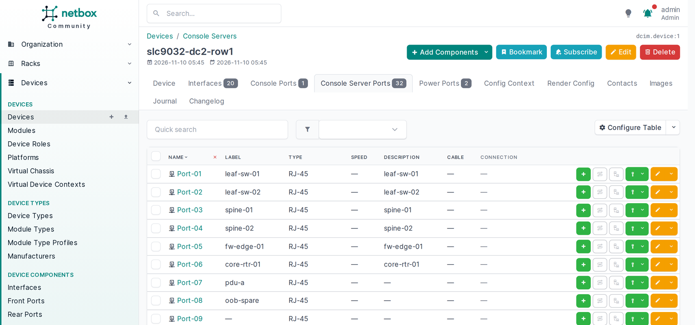
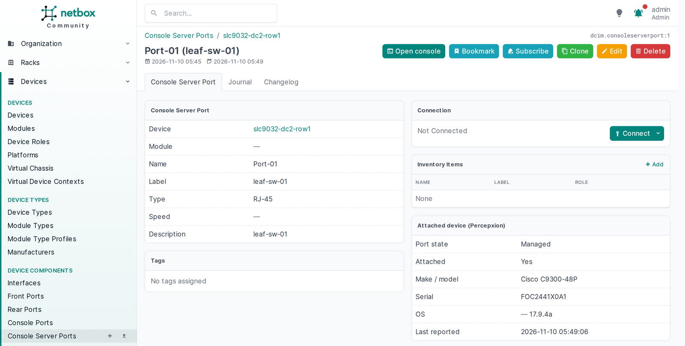
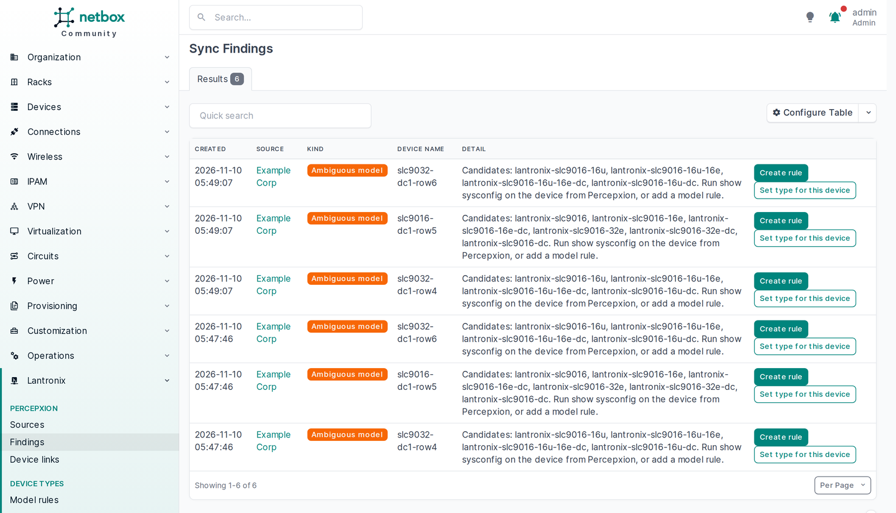

# netbox-lantronix

A NetBox plugin that keeps NetBox current with the Lantronix SLC 9000, SLC 8000 and EMG console servers managed by Percepxion. Nobody has to type console server inventory into NetBox by hand.

On each sync the plugin reads Percepxion and:

- creates the console server in NetBox with the right device type, so its console server ports come from the device type
- labels each console server port with the name configured on the console server, and describes it with the hostname of the attached device
- shows the attached device's make, model, OS and serial on the port, when the console server reports them
- adds an **Open console** button on each port that launches an SSH session through the console server (`ssh://<console server>:<base port + port number>`)
- lists anything it couldn't decide, such as an ambiguous model or a name conflict, as findings with a one-click fix

The plugin never writes to Percepxion or to a console server. It reads from Percepxion and writes to NetBox only.







## Requirements

| | |
|---|---|
| NetBox | 4.6.0 to 4.7.x (the plugin refuses to load on other versions) |
| Python | 3.12 or later |
| RQ worker | A running NetBox worker (`manage.py rqworker`). Scheduled and on-demand syncs run as NetBox background jobs. |
| Percepxion | Percepxion cloud or on-premises, and a Percepxion user with the **tenant_user** role in the organization you sync. No administrator role is needed. |
| Device types | Lantronix SLC and EMG device types, imported before the first sync. The definitions are in [`docker/device-types`](docker/device-types). |

### Compatibility

| netbox-lantronix | NetBox |
|---|---|
| 0.3.0 and later | 4.6 and 4.7 |
| 0.1.0 to 0.2.1 | 4.5 and 4.6 |

CI runs the tests against every NetBox minor version the current release supports. It needs no other NetBox plugins, and its one Python dependency, `requests`, already ships with NetBox.

## Install

1. Install the package into the NetBox virtual environment:

   ```
   source /opt/netbox/venv/bin/activate
   pip install netbox-lantronix
   ```

   To pin a version, install `netbox-lantronix==X.Y.Z` with a version from the [releases](https://github.com/Lantronix/netbox-lantronix/releases). For netbox-docker, follow [Docker](#docker) instead of these steps.

2. Enable and configure the plugin in `configuration.py` (see [Configuration](#configuration)).

3. Run the migrations and collect static files:

   ```
   cd /opt/netbox/netbox
   python3 manage.py migrate netbox_lantronix
   python3 manage.py collectstatic --no-input
   ```

4. Restart NetBox and the RQ worker.

5. Create the NetBox user that sync changes are attributed to, for example `percepxion-sync`, and give it permissions (see [Permissions](#permissions)). It doesn't need to log in.

6. Import the device types for your hardware from [`docker/device-types`](docker/device-types) through **Devices > Device Types > Import**.

On the first run the plugin creates the manufacturer `Lantronix`, the platform `lantronix_itmgos` and the device custom field `percepxion_device_id` if they don't exist, and reuses them if they do. These are the same objects the `lantronix.oob` Ansible collection's NetBox playbook uses, so the two can share a NetBox.

## Docker

This builds a NetBox 4.6 image with the plugin, using [netbox-docker](https://github.com/netbox-community/netbox-docker). You need Docker with Compose and a Percepxion user with the **tenant_user** role.

1. Clone both repositories side by side and copy in the plugin's files:

   ```
   git clone -b 5.0.2 --depth 1 https://github.com/netbox-community/netbox-docker.git
   git clone https://github.com/Lantronix/netbox-lantronix.git
   cd netbox-docker
   cp ../netbox-lantronix/docker/docker-compose.override.yml .
   cp ../netbox-lantronix/docker/plugins.py configuration/plugins.py
   cp ../netbox-lantronix/docker/percepxion.env.example env/percepxion.env
   ```

2. Add your Percepxion username and password to `env/percepxion.env`. For on-premises Percepxion, change `PERCEPXION_URL` too.

3. Build and start NetBox. The first start runs the database migrations and can take several minutes.

   ```
   docker compose build
   docker compose up -d
   ```

4. Create your NetBox login:

   ```
   docker compose exec netbox /opt/netbox/netbox/manage.py createsuperuser
   ```

5. Import the device types and create the `percepxion-sync` user, a site and a role. Its permissions are limited to that site, and running it again changes nothing that already exists.

   ```
   docker compose exec netbox /opt/netbox/netbox/manage.py nbshell -c "exec(open('/opt/netbox-lantronix-docker/setup.py').read())"
   ```

6. Open http://localhost:8000 and follow [First sync](#first-sync), with endpoint `percepxion`, site **Console Servers** and role **Console Server**.

To use another port, set `NETBOX_PORT` when you start NetBox. The stack runs as Compose project `netbox-lantronix`, so its containers and database stay separate from any other netbox-docker on the host.

## Configuration

Endpoints and credentials live only in `configuration.py` or the environment, never in the NetBox database.

```python
import os

PLUGINS = ["netbox_lantronix"]

PLUGINS_CONFIG = {
    "netbox_lantronix": {
        # NetBox user that change records are attributed to. Must exist.
        "sync_user": "percepxion-sync",
        "endpoints": {
            # Name you pick here; a Percepxion source in the UI refers to it.
            "percepxion-cloud": {
                "url": "https://api.percepxion.ai/api",  # API base, including /api
                "username": os.environ["PERCEPXION_USERNAME"],
                "password": os.environ["PERCEPXION_PASSWORD"],
                # Optional:
                # "verify": True,                      # TLS verification, on by default
                # "ca_bundle": "/etc/ssl/px-ca.pem",   # CA bundle for on-premises Percepxion
                # "proxy": "http://proxy.example.com:3128",
            },
        },
    },
}
```

- `url` must use `https://`. The plugin won't load an endpoint that doesn't.
- `username` and `password` are required. They're read when a sync starts and never written to the database, job data, logs or findings.
- A missing key stops the plugin at startup with an error that names the endpoint and the key, never the value.
- Turning `verify` off shows a warning on every source that uses the endpoint.
- Endpoint changes take effect after a NetBox restart.

## First sync

1. Go to **Plugins > Lantronix > Percepxion Sources > Add**.
2. Pick the endpoint and enter the Percepxion organization ID. Then choose the NetBox site and device role for new console servers, the sync interval in minutes (0 turns scheduling off, otherwise at least 5), and the SSH base port (3000 unless you changed it on your console servers).
3. Save, then click **Sync now**. The job appears under the source with its counts and log.
4. Open **Findings**. Each one names the device and the fix.

To sync on events instead of waiting for the schedule, call `POST /api/plugins/lantronix/sources/<id>/sync/` with an API token whose user has the sync permission. It answers 202 with the queued job, or 409 when a run is already queued or running, which will pick up the change.

### Device models

Percepxion reports an SLC 9000's model as its total number of serial ports and doesn't report the Ethernet switch module or the power supply type. Several SLC 9000 SKUs therefore look the same in Percepxion. The plugin picks the device type in this order:

1. **Type override** for that device, if you set one
2. **`show sysconfig` output** stored in Percepxion: if anyone has run `show sysconfig` on the unit through Percepxion (console editor or a CLI job), the plugin reads the exact model and power supply type from that output
3. **Model rule** on the source, matching Percepxion model plus RJ45 and USB port counts to one device type, for fleets that buy one variant
4. A **single device type** that matches the port counts

When none of these settles it, the device isn't created and an "ambiguous model" finding lists the candidate types. **Create rule** and **Override** on the finding open forms with the Percepxion values filled in and the device type choices limited to those candidates. EMG units resolve from Percepxion data alone.

### What the plugin changes in NetBox

| Object | Plugin writes | Plugin never changes |
|---|---|---|
| Console server (device) | created with name, type, site, role, platform, serial; name kept in step with Percepxion | site, role or type of an existing device |
| Console server port | label (the port's name on the console server), description (attached device hostname) | name, cables, anything else |
| Port facts panel | attached device make, model, OS, version, serial, last reported time | |

The console server is the source of truth for port labels and descriptions. A label edited by hand in NetBox is overwritten on the next sync. Rename the port on the console server instead.

The plugin matches Percepxion devices to NetBox devices by its own link, then by serial number, then by name. When a serial match is in a different site from the source, or a name match has no serial to confirm it, the link is created as **pending** and nothing is written until someone with the approve permission approves it. A run writes only objects that changed, so a sync with no changes in Percepxion records no change log entries.

## Permissions

| Permission | Allows |
|---|---|
| `netbox_lantronix.add/change/delete_percepxionsource` | manage sources |
| `netbox_lantronix.sync_percepxionsource` | run **Sync now** or the sync API call, and schedule syncs when saving a source |
| `netbox_lantronix.view_*` | see sources, links, rules, overrides, findings and run history |
| `netbox_lantronix.approve_devicelink` | approve pending device adoptions |
| `netbox_lantronix.add/change_modelrule`, `..._devicetypeoverride` | resolve ambiguous models |

The sync user needs `dcim.view/add/change_device` and `dcim.view/change_consoleserverport`, plus view on device types, sites, roles and platforms. Constrain these with NetBox object permissions, for example to one site, and the plugin stays inside them. A run that would write outside them fails as a whole, with the reason on the job, and changes nothing.

The **Open console** button and the facts panel are shown only to users who can view the device and its ports.

## Open console

The button builds `ssh://<address>:<SSH base port + port number>`. It uses the device's primary IP in NetBox, or the management address Percepxion reports when no primary IP is set. Your browser opens it with your SSH client and you sign in to the console server as yourself.

On the console server, direct SSH access is off by default on every port. Turn it on for the ports you want to reach, for example `set deviceport port 1-48 sshin enable` (answer `yes` to the confirmation), or from the WebUI's device port settings with **Apply Settings** to the ports you choose.

## Troubleshooting

| Symptom | Check |
|---|---|
| Plugin doesn't load | NetBox log names the endpoint and missing key, or a NetBox version outside 4.6 to 4.7 |
| Job stays queued | RQ worker not running |
| Job fails with a login error | Credentials in the environment. After a rejected login, scheduled runs pause for at least 30 minutes. Fix the credentials, restart NetBox, then click **Sync now**; it retries at once only when the credentials changed. |
| Job fails with a permission error | The sync user's object permissions don't cover the device or site named in the error |
| Device missing after a sync | **Findings**: ambiguous model, missing device type, name conflict or pending adoption |
| PuTTY or ssh reports "connection refused" | Direct SSH access is off on that port of the console server (see [Open console](#open-console)) |

## Support

- Bugs and feature requests: [GitHub Issues](https://github.com/Lantronix/netbox-lantronix/issues). Include the plugin and NetBox versions, and the findings or job log from the sync.
- Questions about Percepxion or Lantronix console servers: [Lantronix Technical Support](https://www.lantronix.com/technical-support/).

## License

Apache-2.0
